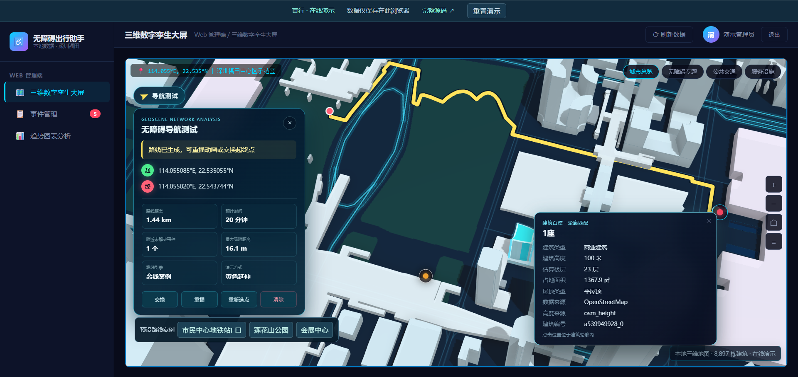
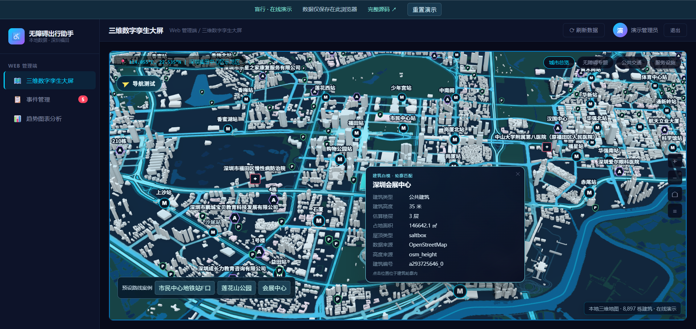
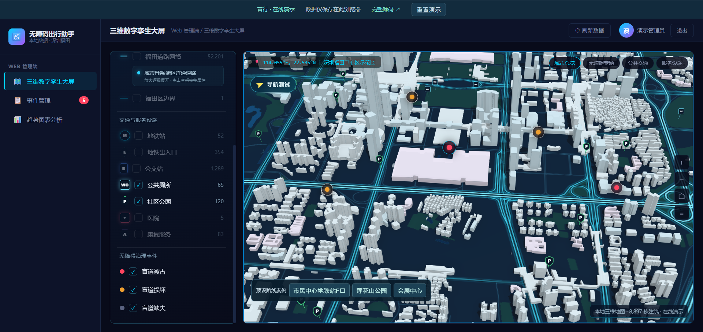

# GIS · 无障碍出行与治理

面向深圳福田的无障碍出行与城市治理项目，包含 Web 三维管理端、移动端、Python 业务后端和 GIS 数据制作工具。

**[在线演示](https://ichangli.github.io/blind-navigation/) · [下载完整源码 ZIP](https://github.com/ichangli/blind-navigation/archive/refs/heads/main.zip) · [本地运行说明](docs/本地运行与演示.md) · [数据与依赖说明](docs/数据与依赖.md)**

本仓库同时提供完整作品源代码和独立的 GitHub Pages 演示。完整源码保留真实后端；Pages 只发布静态演示产物。

## 在线体验

- Web 端：福田三维建筑、道路专题、水域、设施、事件查看与审核、图表。
- 移动端：预设路线案例、步骤播报、公交站点、浏览器本地上报与设置。
- 当前浏览器内的上报、审核和删除可联动，提供一键重置。
- 地图数据直接随网站提供，演示运行不依赖 GeoScene 或本机 Python。

在线演示使用样例业务数据与离线生成的路线，修改仅保存在当前浏览器，不跨设备共享。公交到站、天气和环境感知中的演示内容不代表实时服务。路线案例未经现场通行验证。三维地图需要设备支持 WebGL；加载失败时提供二维本地地图。

## 演示截图

以下截图来自 GitHub Pages 在线演示，点击图片可查看原图。

### 道路与预设路线演示

在三维建筑与青色发光主干路之间，用黄色路径突出展示预设出行路线。导航面板集中呈现案例距离、预计时间和附近样例事件，支持路线重播与起终点交换；点选建筑还可查看类型、高度、楼层和数据来源。图中的路线为离线生成的演示案例。

### 福田三维全景

以 8,897 栋建筑白模呈现福田城市空间，叠加展示主干道路、水域、绿地及交通与服务设施。通过缩放、旋转和倾斜视角观察城市，再点选建筑查看详细属性，从全景浏览切换到局部地标查看。

### 可选图层与专题浏览

通过左侧图层面板按需显示道路网络、区界、地铁站、地铁出入口、公交站、公共厕所、社区公园、医院和康复服务等内容，也可叠加盲道被占、损坏、缺失等样例事件。配合城市总览、无障碍专题、公共交通和服务设施视图，集中查看不同设施与事件的空间分布。图中选中了公共厕所、社区公园与三类事件图层。

## 下载后运行

### 无需地图 Key 的静态演示

需要 Python 3.10 或以上，仅使用标准库：

    python tools/build_pages.py
    python -m http.server 8777 --directory site-demo

然后访问 http://127.0.0.1:8777 。Windows 也可双击 preview_pages.bat。

### 原版完整前后端

需要 Python 3.10 或以上。Windows 可运行根目录 run_demo.bat，使用 SQLite 演示数据库；数据库和管理员初始规则详见启动说明。

手动启动方式：

    python -m venv .venv
    .venv\Scripts\python -m pip install -r backend/requirements.txt
    .venv\Scripts\python -m uvicorn backend.main:app --host 127.0.0.1 --port 8000

访问 http://127.0.0.1:8000 。原版地图和完整导航依赖自行配置的 GeoScene 服务及高德/天地图配置。复制 backend/.env.example 或 backend/.env.demo.example 为 backend/.env 后填写相应字段；本仓库不提供真实凭据。**原版在线服务与独立 Pages 演示的运行条件不同，请按文档选择。**

## 目录

| 路径 | 内容 |
|---|---|
| 根目录 HTML、JS、styles | 原版前端和本机启动脚本 |
| backend | 完整 FastAPI 后端、数据库模型、认证和 API |
| data / shenzhen_data | 样例业务数据、建筑和设施等数据 |
| datasets | 最终网络数据集与底图、展示数据 |
| _dev_archive/gis | 提取、建库、成本计算、拓扑修复和制图工具 |
| _dev_archive/tests | 原有前后端及 GIS 测试 |
| demo | Pages 入口、静态 API 适配器、地图适配器和演示数据 |
| tools/build_pages.py | 从完整源码生成 site-demo 发布目录 |
| tools/export_demo_data.py | 离线重新生成演示数据与路线案例 |
| tests | 静态演示接口与资源测试 |
| vendor | 固定版本的地图显示依赖，保留原版权文件 |

site-demo 为本地构建产物，GitHub Actions 会生成并且只部署这个目录。后端、GIS 工具和测试留在源码仓库中供下载。

## 测试

需要 Node.js 20 或以上：

    npm ci
    npm test

原版测试入口及 GIS 软件依赖参见 _dev_archive/README.md。重新生成演示数据需要额外的 GeoPandas、pyogrio、Shapely、SciPy、pyproj 以及后端依赖；普通访客查看演示不需要安装这些组件。

## 数据和许可

地图数据含 OpenStreetMap 衍生内容，保留 © OpenStreetMap contributors 署名，相关数据遵循其适用许可。设施、底图、建筑及依赖来源见 [数据与依赖说明](docs/数据与依赖.md)。第三方库沿用各自许可证；本项目原创代码尚未单独指定通用开源许可证，公开提供查看与下载，其他使用请与作者确认。

真实环境配置、个人上报数据库、真实用户照片、虚拟环境和历史构建包不属于源码发布内容。

